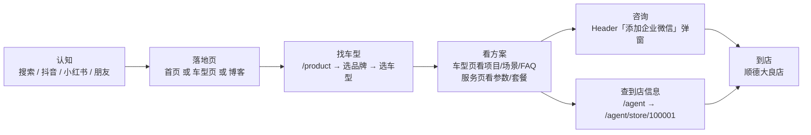

# 官网架构总览

## 一、一句话定位

> 蓝辉轻改官网（`https://lanhuiqinggai.com`）是「顺德大良新能源汽车轻改门店」的**品牌官网 + 车型适配查询工具 + 到店/私域转化入口 + SEO/GEO 内容承接站**。它是一个**纯静态站**：没有后台、没有登录、没有运行时数据库，所有页面在构建时一次性生成为 HTML。

- 品牌名：蓝辉轻改 LANHUI｜Slogan：让爱车更有型，也更好用（`src/lib/brand.ts`）
- 当前门店：蓝辉轻改顺德大良店（`src/lib/store.ts`，门店 ID `100001`）
- 技术形态：Next.js 16.2.1 App Router + `output: "export"`，产物在 `out/`

## 二、网站目标

| # | 目标 | 在网站上的落点 |
|---|---|---|
| 1 | **品牌展示** | `/`（首页）、`/brand`（品牌介绍）、`/brand/history`（品牌历程） |
| 2 | **车型适配查询** | `/product/<品牌>` 系列页 ×12、`/product/<品牌>/<车型>` 车型页 ×19；用户按「品牌 → 车型」找到专属升级方案 |
| 3 | **到店与私域转化** | 全站 Header 的「添加企业微信」弹窗、`/agent`（门店网络）、`/agent/store/100001`（门店详情）、`/contact`（联系方式） |
| 4 | **SEO-GEO 承接** | `sitemap.xml`（74 条 URL）、`robots.txt`（放行 AI 爬虫）、`llms.txt`（AI Agent 导航文件）、全站 canonical + 结构化数据；`/blog` 承载内容型关键词 |

## 三、整站信息架构树

> 共 **59 个 `page.tsx` 路由定义**（其中 9 个是动态路由模板），实际构建出 **120 个内容页面 + 2 个错误页**（见 `03-页面清单与路由地图.md`）。

```
/  首页
│
├── /product  产品中心（总览）
│   │
│   ├── 膜系（group: film）
│   │   ├── /product/ppf                    隐形车衣 PPF
│   │   ├── /product/window-film            汽车窗膜
│   │   │   └── /product/window-film/[packageSlug]   ← 动态，生成 7 个套餐页
│   │   └── /product/color-film             改色膜
│   │
│   ├── 轻改装备（group: light_mod）
│   │   ├── /product/electric-steps         电动踏板
│   │   ├── /product/wheels                 轮毂升级
│   │   ├── /product/chassis                底盘护板
│   │   └── /product/tei-brake              TEI 刹车卡钳
│   │       └── /product/tei-brake/[slug]   ← 动态，生成 33 个型号详情页
│   │
│   ├── 座舱与内饰（group: business_comfort / practical_accessory）
│   │   ├── /product/car-tv                 车载电视
│   │   ├── /product/flooring               汽车地板
│   │   ├── /product/floor-mats             360 软包脚垫
│   │   └── /product/business-comfort       商务舒适升级 ⚪planned（访问即 notFound()）
│   │
│   ├── 养护与美容（group: car_care）
│   │   └── /product/car-care               洗美养护
│   │
│   ├── 品牌系列页（12 个，/product/<brandSlug>）
│   │   ├── 问界 wenjie   → /product/wenjie/m6 · m7 · m8
│   │   ├── 小米 xiaomi   → /product/xiaomi/su7 · yu7
│   │   ├── 极氪 zeekr    → /product/zeekr/9x · 8x
│   │   ├── 理想 li-auto  → /product/li-auto/one · i6 · i8 · l9 · mega
│   │   ├── 特斯拉 tesla  → （暂无车型子页）
│   │   ├── 小鹏 xpeng    → /product/xpeng/gx
│   │   ├── 腾势 denza    → /product/denza/d9
│   │   ├── 岚图 voyah    → /product/voyah/dreamer
│   │   ├── 乐道 ledao    → /product/ledao/l90
│   │   ├── 高山 gaoshan  → /product/gaoshan/8
│   │   ├── 智界 zhijie   → /product/zhijie/v9
│   │   └── 蔚来 nio      → /product/nio/es8
│   │
│   └── 车型详情页（19 个，/product/<brandSlug>/<modelSlug>）
│
├── /agent  门店服务
│   ├── /agent/guangdong                   省页（/agent/[slug]）
│   ├── /agent/guangdong/foshan            市页（/agent/[slug]/[city]）
│   └── /agent/store/100001                门店详情页（/agent/store/[id]）
│
├── /blog  品牌资讯
│   ├── /blog                              列表（每页 9 篇，3×3 网格）
│   ├── /blog/page/1 · /blog/page/2        分页（/blog/page/[page]）
│   ├── /blog/category/cat-case 等 5 个分类（/blog/category/[category]）
│   │   └── /blog/category/<cat>/page/1    分类分页（/blog/category/[category]/page/[page]）
│   └── /blog/<slug> ×15                   ← 动态，15 篇已发布文章
│
├── /brand  品牌介绍
│   └── /brand/history                     品牌历程
│
└── /contact  联系我们
```

### 导航入口（`src/components/Header.tsx` 的 `NAV_ITEMS`）

| 一级导航 | 链接 | 说明 |
|---|---|---|
| 首页 | `/` | — |
| 产品中心 | `/product` | 二级：11 个 live 服务分类 + 12 个 live 品牌（品牌下再挂车型） |
| 门店服务 | `/agent` | `matchPrefix: /agent` |
| 品牌介绍 | `/brand` | 二级：品牌简介 `/brand`、品牌历程 `/brand/history` |
| 品牌资讯 | `/blog` | `matchPrefix: /blog` |

## 四、路由规模一览

| 维度 | 数量 | 数据来源 |
|---|---:|---|
| `page.tsx` 路由定义 | 59 | `find src/app -name page.tsx` |
| 其中动态路由模板（含 `[xxx]`） | 9 | agent ×3、blog ×3、tei-brake ×1、window-film ×1 |
| 实际构建内容页（`out/**/index.html`） | 120 | 另加 `out/404/index.html`、`out/_not-found/index.html` |
| 进 sitemap 的 URL | 74 | `out/sitemap.xml` |
| 品牌（vehicle_brand） | 12 | `ALL_BRANDS` |
| 车型（vehicle_model） | 19 | `ALL_MODELS` |
| 服务/分类（service_category） | 12（11 live + 1 planned） | `ALL_SERVICES` |

## 五、用户旅程图（认知 → 找车型 → 看方案 → 咨询 → 到店）



| 阶段 | 用户动作 | 承接页面 | 转化元件 |
|---|---|---|---|
| 认知 | 从搜索/AI 回答/社媒进入 | `/`、`/blog/<slug>`、`/product/<brand>/<model>` | SEO title / 结构化数据 / llms.txt |
| 找车型 | 按品牌筛选车型 | `/product`、`/product/<brand>` | 品牌矩阵、车型地图 |
| 看方案 | 查看升级项目、参数、案例 | 车型页、产品大类页 | 项目栅格、场景矩阵、FAQ |
| 咨询 | 加微信 / 打电话 | 全站 Header / Footer | `WeChatConsultButton` 弹窗二维码、`tel:` 链接 |
| 到店 | 查看地址与营业时间 | `/agent`、`/agent/store/100001`、`/contact` | LocalBusiness schema、高德导航链接 |

## 六、三类核心内容资产

| 资产 | 载体 | 数量 | 维护位置 |
|---|---|---|---|
| **产品大类** | `/product/<serviceSlug>` | 12 个分类（11 live） | `src/lib/products.ts` + 各品类数据文件（`*-products.ts`） |
| **品牌车型** | `/product/<brand>` / `/product/<brand>/<model>` | 12 品牌 / 19 车型 | `src/lib/product-routes.ts`（路由注册表）+ `*-page-config.ts`（车型页内容配置） |
| **装修案例与博客** | `/blog/<slug>` | 15 篇 Markdown 文章 | `src/content/articles/*.md` |

## 七、数据来源：品牌 / 车型 / 服务清单

> 以下全部**实际读取自 `src/lib/product-routes.ts`**，非人工整理。

### 7.1 品牌（`ALL_BRANDS`，共 12 个，status 全部为 `live`）

| 品牌 | brandSlug | 强调色 | 优先级 | canonicalPath | 车型 modelSlugs |
|---|---|---|---|---:|:---|
| 问界 | wenjie | cyan | P0 | `/product/wenjie` | m6, m7, m8 |
| 小米 | xiaomi | orange | P0 | `/product/xiaomi` | su7, yu7 |
| 极氪 | zeekr | orange | P0 | `/product/zeekr` | 9x, 8x |
| 理想 | li-auto | amber | P1 | `/product/li-auto` | one, i6, i8, l9, mega |
| 特斯拉 | tesla | red | P1 | `/product/tesla` | （无） |
| 小鹏 | xpeng | emerald | P1 | `/product/xpeng` | gx |
| 腾势 | denza | pink | P1 | `/product/denza` | d9 |
| 岚图 | voyah | violet | P1 | `/product/voyah` | dreamer |
| 乐道 | ledao | blue | P1 | `/product/ledao` | l90 |
| 高山 | gaoshan | teal | P1 | `/product/gaoshan` | 8 |
| 智界 | zhijie | amber | P1 | `/product/zhijie` | v9 |
| 蔚来 | nio | sky | P1 | `/product/nio` | es8 |

### 7.2 车型（`ALL_MODELS`，共 19 个）

| 车型 | brandSlug | status | priority | projectCount（注册表值） |
|---|---|---|---:|---:|
| 小米 SU7 | xiaomi | live | P0 | 12 |
| 小米 YU7 | xiaomi | live | P0 | 9 |
| 问界 M6 | wenjie | **planned** | P0 | 17 |
| 问界 M7 | wenjie | **planned** | P0 | 30 |
| 问界 M8 | wenjie | **planned** | P0 | 30 |
| 极氪 9X | zeekr | live | P0 | 18 |
| 极氪 8X | zeekr | live | P1 | 17 |
| 理想 ONE | li-auto | live | P1 | 8 |
| 理想 i6 | li-auto | live | P1 | 20 |
| 理想 i8 | li-auto | live | P1 | 20 |
| 理想 L9 | li-auto | live | P1 | 14 |
| 理想 MEGA | li-auto | live | P1 | 18 |
| 腾势 D9 | denza | live | P1 | 23 |
| 岚图梦想家 | voyah | live | P1 | 17 |
| 小鹏 GX | xpeng | live | P1 | 22 |
| 乐道 L90 | ledao | live | P1 | 21 |
| 高山 8 | gaoshan | live | P1 | 23 |
| 智界 V9 | zhijie | live | P1 | 14 |
| 蔚来 ES8 | nio | live | P1 | 17 |

> ⚠️ **口径提醒（如实记录）**：问界 M6/M7/M8 在注册表中 `status: "planned"`，但仓库里已构建出可访问的页面并出现在 sitemap 中——这是「注册状态与落地状态不一致」，属已知待办（详见 `08-已知问题与改进路线.md`）。

### 7.3 服务/分类（`ALL_SERVICES`，共 12 个）

| 服务 | serviceSlug | group | status | priority |
|---|---|---|---|:---:|---:|
| 隐形车衣 | ppf | film | live | P0 |
| 汽车窗膜 | window-film | film | live | P0 |
| 改色膜 | color-film | film | live | P0 |
| 电动踏板 | electric-steps | light_mod | live | P0 |
| 轮毂升级 | wheels | light_mod | live | P0 |
| 底盘护板 | chassis | light_mod | live | P0 |
| TEI 刹车卡钳 | tei-brake | light_mod | live | P1 |
| 汽车地板 | flooring | practical_accessory | live | P1 |
| 360 软包脚垫 | floor-mats | practical_accessory | live | P1 |
| 车载电视 | car-tv | business_comfort | live | P1 |
| 商务舒适升级 | business-comfort | business_comfort | **planned** | P1 |
| 洗美养护 | car-care | car_care | live | P0 |

## 八、一句话总结

官网的结构可以概括为「**1 个总览（首页）+ 3 类内容资产（产品/车型/博客）+ 1 个转化闭环（微信+门店）**」，全部由数据层文件驱动、构建时静态生成——改内容 = 改数据/改 Markdown + 重新构建发布。
