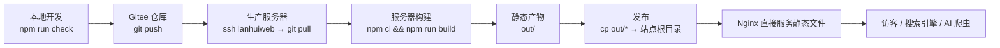

# 部署与运维链路

## 一、整体链路（当前生产实际）



一句话：**Gitee 仓库 → 生产服务器拉取构建 → 静态产物发布 → Nginx 托管**。全程没有 Node 服务端、没有数据库、没有 Docker。

### 生产环境事实（`docs/ops/server-operations.md`）

| 项 | 值 |
|---|---|
| 服务器别名 | `lanhuiweb`（等同 `lanhui-web`） |
| IP | `43.140.225.115` |
| 用户 / 密钥 | `root` / `~/Downloads/lanhuiweb.pem`（权限 600） |
| 系统 | OpenCloudOS 9.6 + 宝塔面板 + Nginx 1.30.3 |
| 规格 | 2 核 1.9G（Next 16 构建约 2-3 分钟，勿跑重负载/并行构建，会 OOM） |
| 源码工作区 | `/root/lanhui-web/`（Gitee clone，含约 820M `node_modules`） |
| 站点根目录 | `/www/wwwroot/lanhuiqinggai.com/`（部署 = 把 `out/*` 拷到这里） |
| Nginx 站点配置 | `/www/server/panel/vhost/nginx/lanhuiqinggai.com.conf` |
| SSL 证书 | `/www/server/panel/vhost/letsencrypt/lanhuiqinggai.com/fullchain.pem` + `privkey.pem` |
| DNS | DNSPod 手动管理，`@` 与 `www` 都指向 `43.140.225.115` |

> ⚠️ 别连错服务器：`hermes`（81.71.132.184）是飞书体系，与官网无关。

### 典型发布命令（据 `server-operations.md`）

```bash
ssh lanhuiweb "cd /root/lanhui-web && git pull origin master"
ssh lanhuiweb "cd /root/lanhui-web && npm ci && npm run build"
ssh lanhuiweb "cp -r /root/lanhui-web/out/* /www/wwwroot/lanhuiqinggai.com/"
```

## 二、仓库内置的部署脚本（`ops/deploy/`）

除宝塔手工发布外，仓库还提供了一套**「原子发布 + 回滚」脚本**（Linux 目录布局）。两套方式择一使用：宝塔方式适合当前小机器；脚本方式更规范、可脚本化。

### `ops/deploy/deploy.sh` 逻辑

| 阶段 | 动作 |
|---|---|
| 1. 参数校验 | 用法：`bash ops/deploy/deploy.sh <path-to-out-dir>`；目录不存在则退出 |
| 2. 产物校验 | 必须存在 `index.html`、`404.html`、`robots.txt`、`sitemap.xml` |
| 3. 创建发布目录 | `/var/www/lanhui/releases/<时间戳>/`，拷贝产物进去 |
| 4. 原子切换 | 软链 `current -> releases/<时间戳>`（`ln -sfn`） |
| 5. Nginx 校验 | `nginx -t`；**失败则自动把软链回滚到上一个版本并退出** |
| 6. 重载 | `nginx -s reload` |
| 7. 冒烟测试 | curl 检查 `/`、`/product/`、`/brand/`、`/contact/`、`/404.html`、`/robots.txt`、`/sitemap.xml` 返回 200 |

目录布局：

```
/var/www/lanhui/
├── releases/
│   ├── 20260719-120000/
│   └── 20260719-150000/
└── current -> releases/20260719-150000/
```

### `ops/deploy/rollback.sh` 逻辑

| 用法 | 行为 |
|---|---|
| `bash ops/deploy/rollback.sh` | 自动回滚到**上一个** release（按 `ls -1t` 取次新） |
| `bash ops/deploy/rollback.sh <release>` | 回滚到指定 release（须含 `index.html`、`404.html`） |
| `bash ops/deploy/rollback.sh --list` | 列出所有可用 release，标记当前版本 |

回滚动作 = 切换 `current` 软链 + `nginx -t` + `nginx -s reload`。

## 三、Nginx 配置要点

仓库模板 `ops/nginx/lanhui.conf` 面向「`www` 域名 + `/var/www/lanhui/current` + `deploy.sh`」；**生产实际**已按 URL Contract 升级为「裸域唯一 + 4 个 server 块」（见下）。两者共同的关键配置如下。

### 3.1 URL 规范化（生产「4 个 server 块」）

```
① http://lanhuiqinggai.com/xxx      → 301 → https://lanhuiqinggai.com/xxx
② http://www.lanhuiqinggai.com/xxx  → 301 → https://lanhuiqinggai.com/xxx（一跳）
③ https://www.lanhuiqinggai.com/xxx → 301 → https://lanhuiqinggai.com/xxx（一跳）
④ https://lanhuiqinggai.com/xxx     → 200（唯一正式版本）
```

- **唯一正式版本**：`https://lanhuiqinggai.com`（裸域），www 必须 301 过去，禁止双活
- **redirect 一跳完成**，禁止链式跳转
- SSL 证书必须**同时覆盖裸域 + www**（SAN 双域名）
- 改配置前先备份（`*.conf.bak-YYYYMMDD`），`nginx -t` 通过才 `nginx -s reload`

### 3.2 SSL / HTTPS

| 项 | 值 |
|---|---|
| 证书 | Let's Encrypt，宝塔自动续期 |
| 协议 | `TLSv1.2 TLSv1.3`（模板） |
| 证书路径 | `/etc/nginx/ssl/lanhui.pem` + `.key`（模板占位）；生产为宝塔路径 |
| HSTS | **当前未开**（模板中注释保留 `max-age=63072000; includeSubDomains; preload`，待 HTTPS 稳定后再开） |

### 3.3 备案

| 项 | 值 | 来源 |
|---|---|---|
| ICP 备案 | 粤ICP备2026102356号-2 | `src/lib/brand.ts` 的 `icp`，Footer 展示并链到 `beian.miit.gov.cn` |
| 公安备案 | 「公安备案号待备案」 | `src/lib/brand.ts` 的 `police`；Footer 会隐藏该行 |

### 3.4 缓存策略

| 路径 | 缓存 | 说明 |
|---|---|---|
| `/_next/static/` | `expires 1y` + `public, immutable` | 内容哈希资源，可永久缓存 |
| `/images/` | `expires 30d` + `public` | 产品图/门店图（已压缩为 WebP） |
| `/robots.txt` `sitemap.xml`（及 `llms.txt`） | `expires 1h` | 短缓存，便于更新 |
| HTML 页面（`/`） | `Cache-Control: no-cache` | 不缓存 HTML，更新即时可见 |
| gzip 对图片 | `gzip off` | 图片已压缩，跳过 gzip |

### 3.5 gzip

```nginx
gzip on;
gzip_comp_level 6;
gzip_min_length 256;
gzip_vary on;
gzip_proxied any;
gzip_types text/plain text/css text/xml text/javascript
           application/javascript application/json application/xml
           application/rss+xml image/svg+xml;
```

### 3.6 安全头

```nginx
add_header X-Content-Type-Options "nosniff" always;
add_header Referrer-Policy "strict-origin-when-cross-origin" always;
add_header Permissions-Policy "camera=(), microphone=(), geolocation=()" always;
add_header X-Frame-Options "DENY" always;
add_header X-XSS-Protection "1; mode=block" always;
# HSTS 待开：add_header Strict-Transport-Security "max-age=63072000; ..." always;
```

### 3.7 404 与隐藏文件

```nginx
error_page 404 /404.html;
location ~ /\. { deny all; access_log off; log_not_found off; }
```

## 四、回滚流程

| 方式 | 操作 | 适用 |
|---|---|---|
| 脚本回滚 | `bash ops/deploy/rollback.sh`（自动上一版）或 `rollback.sh <release>` | 用 `deploy.sh` 原子发布时 |
| 宝塔回滚 | 恢复上一版 `out/` 备份 / 站点目录备份（如 `/www/backup/lanhui-*`），或将 nginx 配置 `.bak-*` 还原 | 当前宝塔直发方式 |
| Nginx 配置回滚 | `cp lanhuiqinggai.com.conf.bak-YYYYMMDD lanhuiqinggai.com.conf && nginx -t && nginx -s reload` | 改了 URL/跳转规则出错时 |

**回滚安全铁律**：任何 nginx 变更都必须先备份、先 `nginx -t`、通过后才 `reload`。

## 五、替代架构（规划/文档中，未上线）

`docs/deployment/static-nextjs/README.md` 描述了另一套更「云原生」的拓扑：

```
Git 内容源 → CI 构建 next export → COS 静态托管 → CDN/HTTPS → 用户
```

- 特点：`next build` 出 `out/`，上传 COS 静态桶，CDN 回源；内容变更走 PR + CI + 预览 + 发布 + 回滚
- 发布顺序（`CONTENT-AND-RELEASE.md`）：先传 `_next/static` 与带版本图片 → 再传其他非 HTML → 最后传 HTML/sitemap/robots → 刷新 CDN HTML 缓存 → 公网冒烟 → 记录 Git SHA/manifest
- 回滚：读上一版 manifest → 恢复 HTML/sitemap → 刷新 CDN HTML 缓存 → 重新冒烟
- **状态**：这是文档中的推荐/规划方案，当前生产仍是「CVM + Nginx + 宝塔」形态（待核实是否已切换）

## 六、运维红线（摘自 `server-operations.md`）

1. 改 nginx 先备份 + `nginx -t` 通过才 reload
2. 不回把生产配置随手删：备份保留，恢复靠 `.bak-*`
3. 服务器是 2C1.9G 小机器，别跑重负载/并行构建（会 OOM）
4. DNS 在 DNSPod 手动管理，`@` 和 `www` 都指向 `43.140.225.115`
5. `lanhuiweb`（官网）与 `hermes`（飞书）必须分清，别连错

## 七、一句话总结

官网是「**构建期生成、运行期只发静态文件**」的形态：内容改完在服务器上 `git pull + build + cp out/`（或走 `deploy.sh` 原子发布），Nginx 负责 URL 规范化、缓存、gzip 与安全头，出问题用 `rollback.sh` 或宝塔备份回滚。
