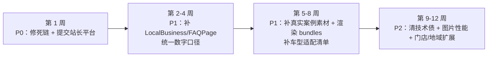

# 已知问题与改进路线

> 本文汇总自 `01-页面说明/` **全部 59 篇文档的「九、待办 / 风险」章节**（已逐篇扫描），并按 P0/P1/P2 分级。每条注明证据来源；未在源码核实到的写「待核实」。

## 一、P0（影响可用性 / SEO 基线 / 转化风险，建议优先）

| # | 问题 | 影响 | 证据来源 |
|---|---|---|---|
| P0-1 | `/product/business-comfort` 是 `planned` 占位页，访问即 `notFound()`，但**保留了 canonical 与 title**，且 `product-landing.ts` 的组合引用了它 | 可能存在**指向 404 的死链**；SEO 上属资源浪费/口径不一致 | `02-产品大类页/商务舒适升级.md`；源码 `src/app/product/business-comfort/page.tsx` |
| P0-2 | **未提交任何搜索引擎站长平台**（GSC/Bing/百度），收录 = 0 | 搜索引擎不知道网站存在，零自然流量（审计称为「最大短板」） | `docs/audits/seo-audit-lanhui-20260808.md`（🔴 P0）；`docs/audits/brand-diagnosis-lanhui-20260811.md`（搜索可见度 3/10） |
| P0-3 | 问界 M6/M7/M8 在注册表 `status: "planned"`，但**页面已构建可访问并进 sitemap** | 注册状态与落地状态不一致；若业务未确认上线，存在对外承诺风险 | `src/lib/product-routes.ts`（wenjie m6/m7/m8 三条）；`03-品牌系列页/问界.md`、`04-车型详情页/问界M6/M7/M8.md` |
| P0-4 | 部分升级项目涉及法规/安全（灯光类、电吸门、旋转座椅、电动门、运动方向盘安全气囊等），页面仅提示「需到店确认」，**部分页面缺合规声明**（如蔚来 ES8 页尾缺合规声明） | 合规风险与用户预期差 | `04-车型详情页/蔚来ES8.md`、`腾势D9.md`、`理想ONE.md`、`小米SU7.md`、`04-车型详情页/理想MEGA.md` |
| P0-5 | 电话 CTA 一致性：`contactData.hotline` 为占位 400 号码（`400-XXX-XXXX`）未启用；`brand.police` 为「公安备案号待备案」（Footer 隐藏该行） | 对外信息不完整 / 可能误拨 | `01-核心页面/联系我们.md`、`01-核心页面/品牌介绍.md`；源码 `src/lib/brand.ts` |

## 二、P1（影响体验 / SEO 覆盖 / 转化）

### 2.1 数据口径不一致（同源不同数）

| # | 问题 | 证据来源 |
|---|---|---|
| P1-1 | **路由注册表 `projectCount` 与页面实际渲染数不符**：小米 SU7（注册 12 vs 实际 21）、小鹏 GX（注册 22 vs 实际 15）、蔚来 ES8（副标题 17 vs 渲染 16） | `04-车型详情页/小米SU7.md`、`小鹏GX.md`、`蔚来ES8.md`；`src/lib/product-routes.ts` |
| P1-2 | 首页文案「当前覆盖 6 个产品方向」与实际已上线服务数（11+）不一致 | `01-核心页面/首页.md` |
| P1-3 | 产品中心 `VehicleTopicMap` 副标题「11 个热门品牌 + 13 款主流车型」与实际 12 个 live 品牌不符；代码注释「8 普通品牌」也与实际 9 个不符 | `01-核心页面/产品中心.md` |
| P1-4 | TEI 页 H2「支持前轮 / 后轮 / 前后通用」与数据（无「前后通用」实际产品）口径不一致 | `02-产品大类页/TEI刹车卡钳.md` |
| P1-5 | 极氪 8X / 蔚来 ES8 的「适合」标签渲染为**英文内部 key**（如 new-car-protection / protection），与其他车型中文标签不一致 | `04-车型详情页/极氪8X.md`、`蔚来ES8.md` |
| P1-6 | 乐道 L90 的 SEO Title 含「电动踏板」但页面 21 项主项目并无该项 | `04-车型详情页/乐道L90.md` |

### 2.2 SEO / GEO 结构化数据缺口

| # | 问题 | 证据来源 |
|---|---|---|
| P1-7 | 首页只有 Organization schema，**缺 LocalBusiness + FAQPage** | `docs/audits/seo-audit-lanhui-20260808.md`（🟠 中优先级）；`06-SEO与GEO现状.md` 第五节 |
| P1-8 | **TEI 33 个型号详情页未纳入 sitemap**，抓取依赖总页内链 | `02-产品大类页/TEI刹车卡钳.md`、`05-动态路由模板/TEI卡钳详情模板.md` |
| P1-9 | 多个产品大类页**缺 Product / ItemList 结构化数据**（改色膜、汽车窗膜、轮毂、隐形车衣等；仅 car-tv/chassis 有 Product） | `02-产品大类页/改色膜.md`、`汽车窗膜.md`、`轮毂升级.md`、`隐形车衣-PPF.md` |
| P1-10 | 博客分类页 / 分页页未进 sitemap（**部分为有意设计**：分类与分页共用 canonical 避免重复内容） | `05-动态路由模板/博客分类模板.md`、`博客分类分页模板.md`、`博客分页模板.md` |

### 2.3 内容缺失（多为「源码未提供」）

| # | 问题 | 证据来源 |
|---|---|---|
| P1-11 | **价格 / 质保年限源码普遍未提供**（几乎全部品牌页与车型页） | `03-品牌系列页/全部 12 篇`、`04-车型详情页/全部 19 篇` |
| P1-12 | **项目图为 AI 预览示意（`product-preview`）/ `pending-review`，非真实施工案例**；理想 i8 甚至未接入路径（项目卡无图） | `04-车型详情页/` 各篇；`04-车型详情页/理想i8.md` |
| P1-13 | **已定义但未渲染的数据**（信息浪费）：`bundles`（理想全系、极氪 8X/9X、蔚来 ES8、智界 V9、小鹏 GX）、`ledaoL90MoreChoices`、`projectType`（高山 8）、`carMatValues`（脚垫）、窗膜详情页的 `painPoints/scenarios` 等 | `04-车型详情页/理想L9.md` 等；`02-产品大类页/360软包脚垫.md`、`05-动态路由模板/窗膜套餐详情模板.md` |
| P1-14 | 问界品牌页 34 个项目清单仅在源码登记，品牌页未渲染 | `03-品牌系列页/问界.md` |
| P1-15 | 案例图曝光受限：360 软包脚垫 29 张、轮毂 21 张默认只展示 8 张 | `02-产品大类页/360软包脚垫.md`、`轮毂升级.md` |
| P1-16 | 多数产品页**无车型适配清单**，用户难以自助判断 | `02-产品大类页/底盘护板.md`、`改色膜.md`、`电动踏板.md`、`车载电视.md` |

### 2.4 转化路径优化

| # | 问题 | 证据来源 |
|---|---|---|
| P1-17 | 首页 Hero 首屏无真实素材图，视觉全依赖渐变 | `01-核心页面/首页.md` |
| P1-18 | 部分页面**无到店/电话 CTA**：窗膜套餐详情页、博客分页页、品牌页、品牌历程页 | `05-动态路由模板/窗膜套餐详情模板.md`、`博客分页模板.md`、`01-核心页面/品牌介绍.md`、`品牌历程.md` |
| P1-19 | 门店详情页**无地图/导航按钮**（已有经纬度数据但未在页面使用），到店引导缺失 | `05-动态路由模板/门店详情模板.md` |
| P1-20 | 「咨询此款」未透传款式信息，客服无法从弹窗直接得知用户意向款 | `02-产品大类页/电动踏板.md` |
| P1-21 | 微信入口仅依赖 Header 弹窗，未提供可直接复制的微信号 | `01-核心页面/首页.md`、`联系我们.md` |

## 三、P2（技术债 / 体验优化 / 内容增强）

| # | 问题 | 证据来源 |
|---|---|---|
| P2-1 | `products.ts` 与 `color-film-data.ts` **双份系列数据**，字段口径不一致，维护成本高 | `02-产品大类页/改色膜.md` |
| P2-2 | `ProductDetail.tsx` 保留死代码（chassis / PPF Hero 文案），改文案易误伤 | `02-产品大类页/底盘护板.md`、`隐形车衣-PPF.md` |
| P2-3 | 图片路径含中文（如 `图片/理想/`），跨平台/CDN 兼容性风险 | `02-产品大类页/汽车地板.md` |
| P2-4 | 门店详情门头图硬编码，多门店会「千店一面」，建议改读 `store.image` | `05-动态路由模板/门店详情模板.md` |
| P2-5 | 阅读时长按字数估算未人工校准；`dateModified` = `datePublished`（改稿不体现更新） | `05-动态路由模板/博客文章详情模板.md` |
| P2-6 | 博客分类描述硬编码在代码（`CATEGORY_DESC`），改文案需改代码 | `05-动态路由模板/博客分类模板.md` |
| P2-7 | 博客无搜索框；分类 Tab 无文章计数 | `01-核心页面/博客列表.md`、`05-动态路由模板/博客分类模板.md` |
| P2-8 | 分页器在 >5 页时页码全量铺开、未做省略号 | `05-动态路由模板/博客分页模板.md` |
| P2-9 | 门店列表搜索为纯前端过滤（最多 6 条），未接后端；门店增多需评估性能 | `01-核心页面/代理商门店网络.md` |
| P2-10 | 地域覆盖有限：仅广东省 1 个省页、佛山 1 个城市页、1 家门店 | `05-动态路由模板/代理商城市页模板.md`、`门店城市列表模板.md` |
| P2-11 | TEI 参数为 `null` 的型号显示「—」；`series/pistonCount` 缺省表达可优化 | `05-动态路由模板/TEI卡钳详情模板.md` |
| P2-12 | 汽车地板质保仅 1 年，相对车衣/窗膜（5-12 年）偏短，未说明原因 | `02-产品大类页/汽车地板.md` |
| P2-13 | 洗美养护 Hero 角标「官方抖音 · 蓝辉轻改」疑似误置；无价目/时长结构化展示 | `02-产品大类页/洗美养护.md` |
| P2-14 | 联系人页 `wechat` 字段已定义但未渲染，微信走 Header 弹窗 | `01-核心页面/联系我们.md` |
| P2-15 | 图片性能：`/product/flooring` LCP ≈ 6.6s、`/brand/certifications` LCP ≈ 6.0s（规格文档记录，落地**待核实**） | `docs/SPEC/图片性能.md` |

## 四、共性问题总结（提炼）

| 主题 | 表现 | 涉及范围 |
|---|---|---|
| **「源码有数据、页面没渲染」** | `bundles`、`moreChoices`、`projectType`、`carMatValues`、窗膜 `painPoints/scenarios` 等已定义未用 | 车型页为主，约 10+ 处 |
| **「价格/质保/参数缺失」** | 合规原因不写价格可以理解，但质保年限、适配车型清单普遍缺失 | 品牌页 12 + 车型页 19 + 多个产品页 |
| **「数字口径不一致」** | projectCount、首页服务数、品牌数、项目数多处对不上 | 首页、产品中心、3 个车型页、问界品牌页 |
| **「素材是示意不是实拍」** | 项目图大量 `product-preview`，缺真实施工案例 | 各车型页、多产品页 |
| **「转化入口分布不均」** | 部分页面缺 CTA / 导航 / 透传 | 窗膜详情、博客分页、品牌页、门店页 |

## 五、建议改进顺序（90 天视角）

| 阶段 | 动作 | 对应条目 |
|---|---|---|
| 第 1 周 | 修 business-comfort 死链；提交 GSC/Bing/百度 + sitemap；确认问界 M6/M7/M8 状态口径 | P0-1 / P0-2 / P0-3 |
| 第 2-4 周 | 首页补 LocalBusiness + FAQPage；产品页补 Product/ItemList；统一 projectCount 与页面数字 | P1-1~P1-9 |
| 第 5-8 周 | 补真实施工素材；渲染已定义的 `bundles`/`moreChoices`；补适配清单与质保信息 | P1-11~P1-16 |
| 第 9-12 周 | 清技术债（双份数据、死代码）；图片性能达标；门店/地域与 CMS 化评估 | P2-1~P2-15 |
| 持续 | 博客周更 + 站外运营（呼应品牌诊断 90 天路线） | `docs/audits/brand-diagnosis-lanhui-20260811.md` |

## 六、一句话总结

官网**技术底子好、问题集中在「内容运营与一致性」**：优先修 P0（死链 + 收录提交 + 状态口径），再补 P1（结构化数据 + 数字口径 + 真实素材 + 转化入口），P2 技术债可随迭代清理。
